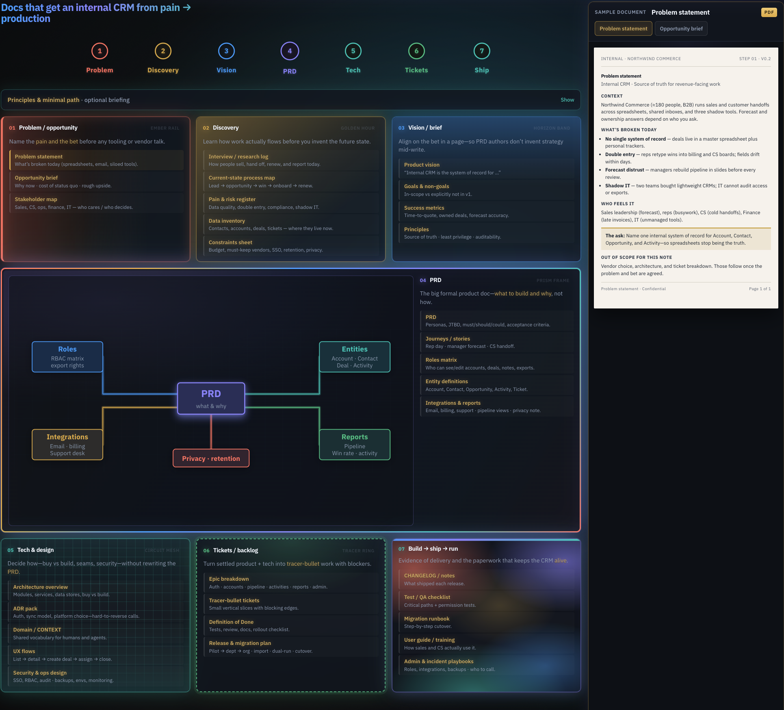

# Hi there, I'm Johan

Software engineer · fullstack · cloud & infra. Based in New Zealand.

  

I like the unglamorous parts of the job: services that stay up, pipelines that don't need babysitting, and infra that's reproducible instead of hand-built. I came to software through data and systems work, so I'm comfortable on both sides of the API — schema and query performance on one end, service architecture and deployment on the other.

  
  

  

  

## Building in public: a microservices replica

Most of my free-time energy goes into personal projects, on purpose: I want a **working reference system** I can break, instrument, and rebuild — not another tutorial-shaped repo.

- **Decompose** — service boundaries by domain, not convenience
- **Talk** — HTTP where it's simple, events where the complexity is earned
- **Ship** — Docker, CI that gates merges, deploys that are boring
- **Provision** — Terraform, no clicking around consoles
- **Observe** — logs, metrics, tracing so failures are explainable
- **Then smaller** — the same system on a local k3s cluster

Some repos are finished, some are scaffolding, some taught me what not to do. That's the point.

## Featured

### Docs that get an internal CRM from pain → production

A product-docs workspace that takes an internal CRM from spreadsheet pain to a shippable system. One canvas holds the path — **Problem → Discovery → Vision → PRD → Tech → Tickets → Ship** — while the right rail is the actual document. The PRD sits in the middle of the map (roles, entities, integrations, reports, privacy).

*Private / in progress — repo link when I publish it.*

  

- **[probable-spork](https://github.com/rimkahan888/probable-spork)** — dashboard & reporting; where I started bridging app code and data
- **[youtube-transcript-tool](https://github.com/rimkahan888/youtube-transcript-tool)** — Python CLI for pulling and processing video transcripts at scale
- **[personal_finance](https://github.com/rimkahan888/personal_finance)** — full-stack personal finance tracker
- **[Language_Tool](https://github.com/rimkahan888/Language_Tool)** — vocabulary trainer: flashcards, quizzes, progress
- **[snowflake-mcq-dashboard](https://github.com/rimkahan888/snowflake-mcq-dashboard)** — quiz dashboard on a warehouse backend
- **[daily_python](https://github.com/rimkahan888/daily_python)** — daily practice; the habit repo

  

## Let's talk

Backend architecture, infrastructure, or what I'm building next.

  <picture>
    <source media="(prefers-color-scheme: dark)" srcset="https://raw.githubusercontent.com/rimkahan888/rimkahan888/output/github-contribution-grid-snake-dark.svg" />
    <source media="(prefers-color-scheme: light)" srcset="https://raw.githubusercontent.com/rimkahan888/rimkahan888/output/github-contribution-grid-snake.svg" />
    
  </picture>

