<!--
Full text version: READMEbackup.md
Projects: edit .github/featured-projects.json (repo + one-sentence summary, max 6).
The Projects list below is rebuilt daily by .github/workflows/recent-repos.yml.
-->

<b>Project links</b>

<!-- Variation A: paste over the 
…
 Project links block in README.md -->
<!-- Heads-up: .github/workflows/recent-repos.yml rebuilds the RECENT_REPOS block daily (02:30 UTC). To keep this layout, also replace .github/featured-projects.json with featured-projects.new.json and .github/scripts/update-recent-repos.py with update-recent-repos.var-a.py (same folder as this file). -->

<b>Project links</b>

<!-- RECENT_REPOS:START -->
- ⚡ **[pokemon-api-dotnet](https://github.com/rimkahan888/pokemon-api-dotnet)** — *PokéAPI explorer & team builder* · $`\small\color{#E8C36A}\textsf{TypeScript}`$ · **.NET** Web API + **Vue 3** front end · tests, CI, Docker, OpenAPI
- 🎲 **[rat-race-escape](https://github.com/rimkahan888/rat-race-escape)** — *Personal-finance board game* · $`\small\color{#E8C36A}\textsf{C\#}`$ · **.NET 10** rules engine & API + **Vue 3 / TypeScript** board · tested in CI
- 🏀 **[nba-player-hub](https://github.com/rimkahan888/nba-player-hub)** — *NBA player hub, original artwork* · $`\small\color{#E8C36A}\textsf{C\#}`$ · bios, stats & contracts · **.NET 10**, **ASP.NET Core**, **Blazor**
- 🧭 **[SDLC](https://github.com/rimkahan888/SDLC)** — *AI-native software lifecycle* · $`\small\color{#E8C36A}\textsf{TypeScript}`$ · cheatsheet & prompt builder · **Vue** app + **ASP.NET Core** API
- ❄️ **[snowflake-mcq-dashboard](https://github.com/rimkahan888/snowflake-mcq-dashboard)** — *Snowflake exam study app* · $`\small\color{#E8C36A}\textsf{TypeScript}`$ · search, favorites, light/dark theme · **Next.js**
- 🇫🇷 **[Language_Tool](https://github.com/rimkahan888/Language_Tool)** — *French vocabulary trainer* · $`\small\color{#E8C36A}\textsf{HTML}`$ · flashcards, quizzes & example sentences · in the browser
<!-- RECENT_REPOS:END -->

  <picture>
    <source media="(prefers-color-scheme: dark)" srcset="https://raw.githubusercontent.com/rimkahan888/rimkahan888/output/github-contribution-grid-snake-dark.svg" />
    <source media="(prefers-color-scheme: light)" srcset="https://raw.githubusercontent.com/rimkahan888/rimkahan888/output/github-contribution-grid-snake.svg" />
    
  </picture>

  

